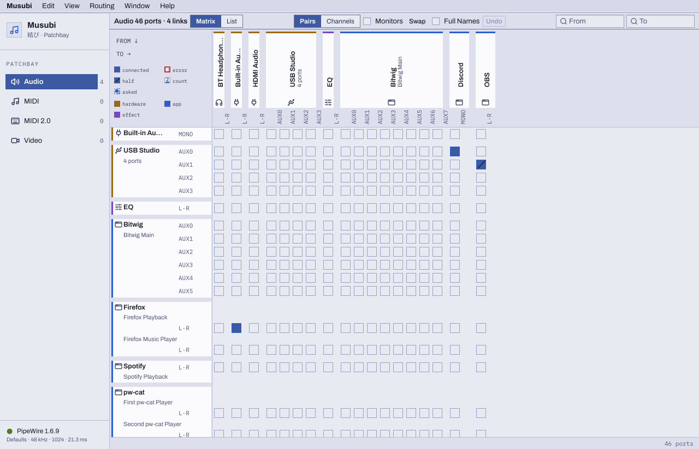
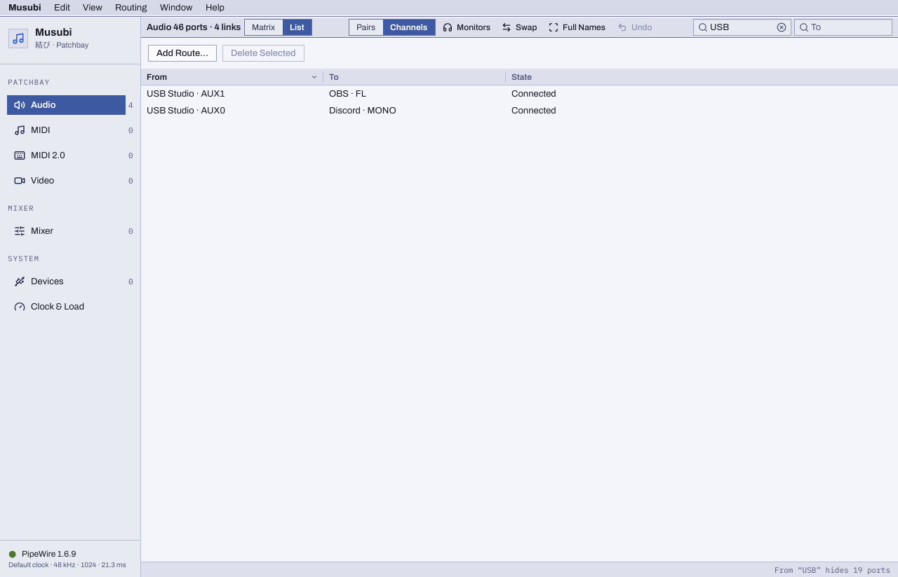
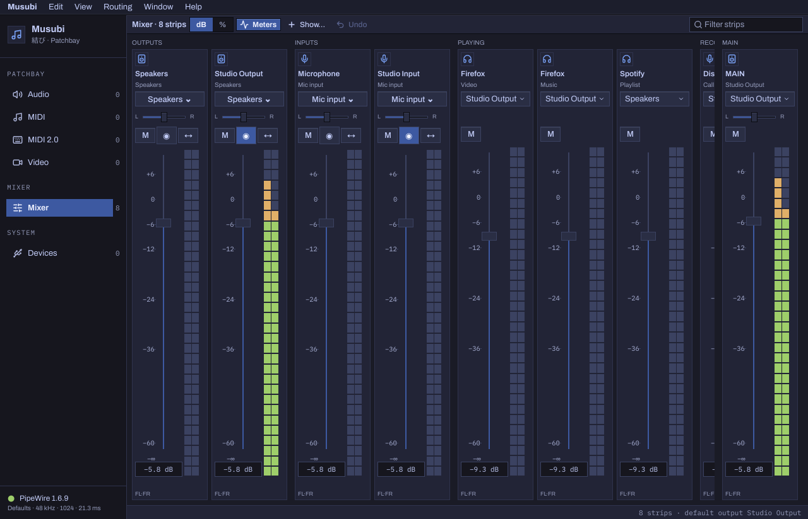
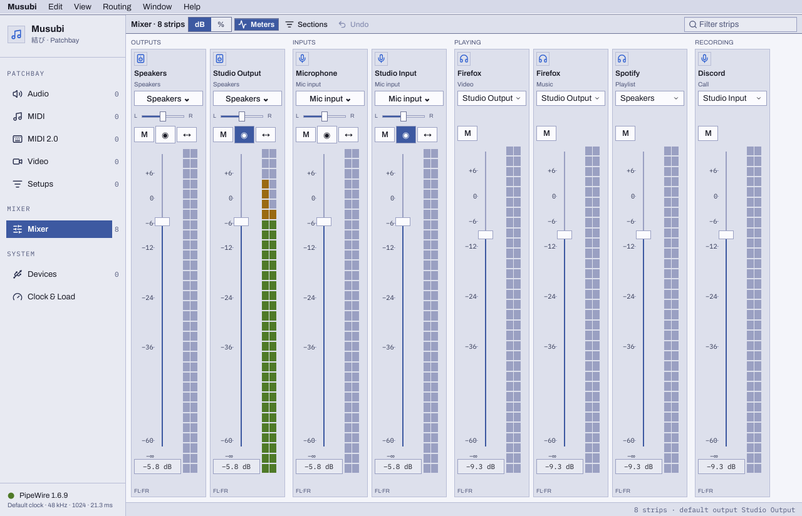
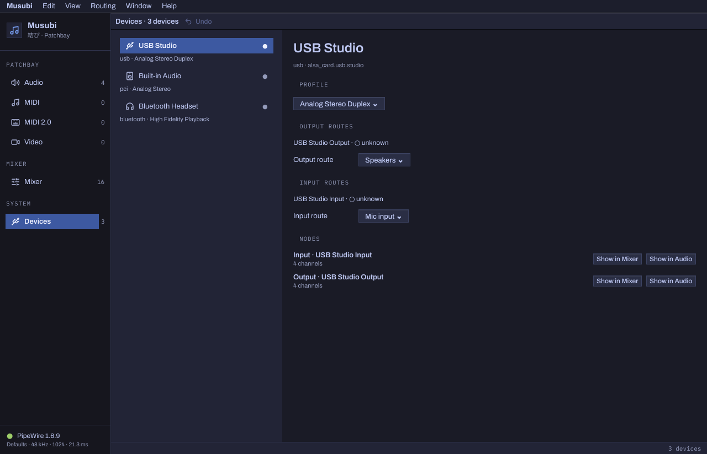
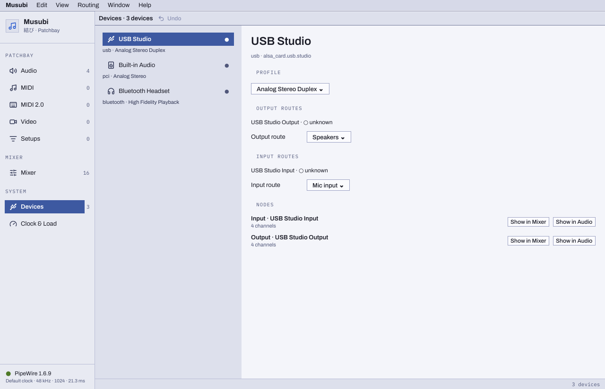

# Musubi 結び — Patchbay

See what is connected in PipeWire, make the next connection yourself, and set levels. Musubi puts sources on one axis and destinations on the other: click a cell to connect or disconnect a port. A line drag applies several connections together; Undo reverses the action. Audio, MIDI 1.0, MIDI 2.0 and video each have their own page. Switch to List to inspect, filter and change routes without using the grid. The Mixer page has a fader, meter, mute and balance per device and app stream; the Devices page switches profiles and routes. Effects adds stereo EQ chains as virtual outputs, each its own user service; Clock & Load forces the graph's rate and buffer size and shows DSP load.

**Status:** early and unpolished; phases 1 (patchbay), 2 (mixer, meters, devices) and 3 (EQ effects, clock & load) of a larger plan (saved setups come later). Musubi is a power-user tool for Aizome on [Sekka](https://github.com/bitemyapp/sekka) and is not part of Sekka's app catalog.

| Night | Day |
| --- | --- |
|  |  |
|  |  |
|  |  |
|  |  |

These are headless Aizome Harness goldens with fixture ports, not screenshots of a live session.

## Use it

With Nix flakes, from this checkout:

```sh
nix run github:raptros/aizome-musubi
```

For NixOS, add this flake as an input, import its module and enable the app:

```nix
{
  inputs.musubi.url = "github:raptros/aizome-musubi";
  inputs.nixpkgs.follows = "musubi/nixpkgs";
  outputs = { nixpkgs, musubi, ... }: {
    nixosConfigurations.myMachine = nixpkgs.lib.nixosSystem {
      system = "x86_64-linux";
      modules = [ musubi.nixosModules.default ({ ... }: { programs.musubi.enable = true; }) ];
    };
  };
}
```

Replace `myMachine` with your system's name; alternatively import `musubi.nixosModules.default` into an existing NixOS configuration and set `programs.musubi.enable = true;`. The flake builds on x86_64 Linux and includes a desktop launcher and scalable icon. PipeWire must be running to show and change real routes. It does not start PipeWire or a session manager for you.

The Audio toolbar offers stereo Pairs or individual Channels, monitor ports, axis Swap and independent From/To filters. Applications are grouped under their name, with each stream's own title beneath, so two players of one app stay apart. Long names are shortened to the part that tells siblings apart; hover a name for all of it, drag the edge of a header to widen it (double-click fits it), or turn on **Full Names** (Option+Super+F) to see everything. MIDI 2.0 can show MIDI 1.0 ports and asks before crossing formats. The inspector shows the selected port's facts and connections. The route list has sortable columns and an Add Route sheet. In both views Musubi shows the graph as PipeWire reports it; a requested link is pending until the server reports it, and errors are shown rather than silently accepted. View choices are stored in `$XDG_CONFIG_HOME/aizome/musubi.toml` (or `~/.config/aizome/musubi.toml`).

## Keyboard

| Keys | Action |
| --- | --- |
| Tab, arrows, Space | Focus the matrix, move between cells, toggle a connection |
| Alt+arrows, Home/End, Page Up/Down | Jump groups, row ends, or a screen in the matrix |
| Enter | Open the selected cell's inspector |
| Shift+Space, arrows, Space | Start, extend and apply a line of connections; Escape cancels |
| Super+1…4 | Audio, MIDI, MIDI 2.0, Video pages |
| Up/Down, Page Up/Down, Home/End (focused fader) | ±1 dB, ±6 dB, 0 dB, −∞; double-click the value box to type a level |
| Super+Z / Super+Shift+Z | Undo / redo |
| Alt+Super+S / Alt+Super+I / Alt+Super+F | Swap axes / toggle inspector / full names |
| Delete or Backspace | Remove selected routes in List view |

The View, Edit and Routing menus expose commands without needing the grid. In List view, use Tab to reach the table and Add Route sheet; filter the same From/To fields. On platforms using a different command modifier, use the shortcuts shown by the app menu.

## Limits

Musubi has no saved setups yet. Effects are stereo EQ chains on a virtual output (no input/voice EQ, LADSPA or LV2 plugins); Clock & Load forces the graph's rate and quantum and shows DSP load, but doesn't measure round-trip latency. The Mixer writes Pulse-visible volume, mute, balance, defaults, routes and profiles through Aizome's audio service (the same as Settei), so a refused change can show for up to a second before the server's value returns; the status bar names the error. App streams have no balance control yet, and nodes Pulse cannot see get a fader only when they are filters (JACK clients stay read-only for now). Meters run only while visible, at most 24 at a time. PipeWire must expose compatible ports: a stream without a session manager may have **no ports** to display until the session manager sets up its routing. If PipeWire is unreachable, Musubi shows an unavailable message and keeps trying to reconnect rather than showing stale routes. An empty video or MIDI page does not mean hardware has been configured. WirePlumber can re-create its automatic links after you remove them; the status message explains this when observed. Hardware, permissions and session-manager support determine what you can connect.

## Effects recovery

If the GUI cannot start, `aizome-musubi effects list` shows saved chains, `aizome-musubi effects remove <chain>` stops/disables one unit and removes its JSON and conf, and `aizome-musubi effects remove-all` stops/disables all Musubi effect units and removes only Musubi's effects directory and clock drop-in. These commands use the user systemd manager; they do not require the GUI.

If that command cannot run, these manual commands do the same, removing only the files Musubi creates:

```sh
systemctl --user list-unit-files --no-legend 'aizome-musubi-effect@*.service' | awk '{print $1}' | xargs -r systemctl --user disable --now
dir="${XDG_CONFIG_HOME:-$HOME/.config}/aizome-musubi/effects"
rm -f "$dir"/*.json "$dir"/*.conf "$dir"/.musubi-*.tmp; rmdir "$dir" 2>/dev/null
rm -f "${XDG_CONFIG_HOME:-$HOME/.config}/pipewire/pipewire.conf.d/90-aizome-musubi-clock.conf"
```

Do not remove other PipeWire configuration. Deleting a chain through Musubi likewise stops and disables its service before removing its `.json` and `.conf` files.

## Setups recovery

If the GUI cannot start, `aizome-musubi setups list` shows saved setups (including damaged JSON as errors), `aizome-musubi setups remove <id>` deletes one setup and stops/disables the keeper when it was active, and `aizome-musubi setups remove-all` stops/disables the keeper and removes managed setup files and `active.json` while keeping foreign files. Unit operations use the user systemd manager; cleanup continues past individual failures.

If the CLI cannot run, stop the keeper first, then remove only Musubi's setup data:

```sh
systemctl --user disable --now aizome-musubi-keeper
dir="${XDG_DATA_HOME:-$HOME/.local/share}/aizome/musubi"
rm -f "$dir"/setups/*.json "$dir"/setups/.musubi-*.tmp "$dir"/active.json
rmdir "$dir"/setups 2>/dev/null
```

## License

MIT OR Apache-2.0. See [LICENSE-MIT](LICENSE-MIT) (Aidan Coyne) and [LICENSE-APACHE](LICENSE-APACHE).
