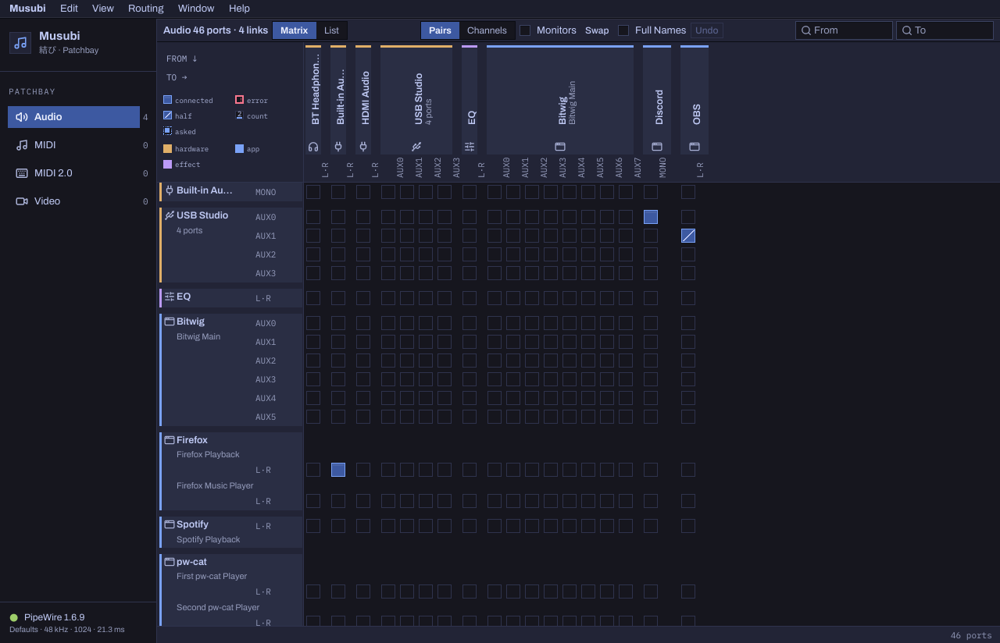
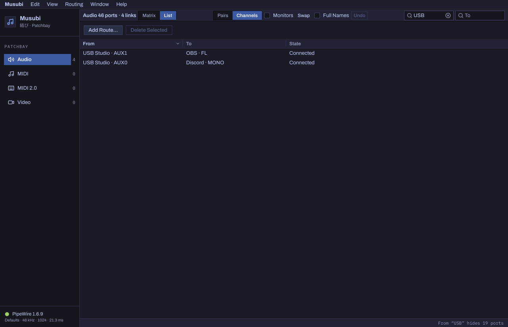

# Musubi 結び — Patchbay

See what is connected in PipeWire and make the next connection yourself. Musubi puts sources on one axis and destinations on the other: click a cell to connect or disconnect a port. A line drag applies several connections together; Undo reverses the action. Audio, MIDI 1.0, MIDI 2.0 and video each have their own page. Switch to List to inspect, filter and change routes without using the grid.

**Status:** early and unpolished; phase 1 of a larger plan (mixer, effects and saved setups come later). Musubi is a power-user tool for Aizome on [Sekka](https://github.com/bitemyapp/sekka) and is not part of Sekka's app catalog.

| Night | Day |
| --- | --- |
|  |  |
|  |  |

These are headless Aizome Harness goldens with fixture ports, not screenshots of a live session.

## Use it

With Nix flakes, from this checkout:

```sh
nix run github:raptros/aizome-musubi
```

For NixOS, add this flake as an input, import its module and enable the app:

```nix
{
  inputs.musubi.url = "github:raptros/aizome-musubi";
  inputs.nixpkgs.follows = "musubi/nixpkgs";
  outputs = { nixpkgs, musubi, ... }: {
    nixosConfigurations.myMachine = nixpkgs.lib.nixosSystem {
      system = "x86_64-linux";
      modules = [ musubi.nixosModules.default ({ ... }: { programs.musubi.enable = true; }) ];
    };
  };
}
```

Replace `myMachine` with your system's name; alternatively import `musubi.nixosModules.default` into an existing NixOS configuration and set `programs.musubi.enable = true;`. The flake builds on x86_64 Linux and includes a desktop launcher and scalable icon. PipeWire must be running to show and change real routes. It does not start PipeWire or a session manager for you.

The Audio toolbar offers stereo Pairs or individual Channels, monitor ports, axis Swap and independent From/To filters. Applications are grouped under their name, with each stream's own title beneath, so two players of one app stay apart. Long names are shortened to the part that tells siblings apart; hover a name for all of it, drag the edge of a header to widen it (double-click fits it), or turn on **Full Names** (Option+Super+F) to see everything. MIDI 2.0 can show MIDI 1.0 ports and asks before crossing formats. The inspector shows the selected port's facts and connections. The route list has sortable columns and an Add Route sheet. In both views Musubi shows the graph as PipeWire reports it; a requested link is pending until the server reports it, and errors are shown rather than silently accepted. View choices are stored in `$XDG_CONFIG_HOME/aizome/musubi.toml` (or `~/.config/aizome/musubi.toml`).

## Keyboard

| Keys | Action |
| --- | --- |
| Tab, arrows, Space | Focus the matrix, move between cells, toggle a connection |
| Alt+arrows, Home/End, Page Up/Down | Jump groups, row ends, or a screen in the matrix |
| Enter | Open the selected cell's inspector |
| Shift+Space, arrows, Space | Start, extend and apply a line of connections; Escape cancels |
| Super+1…4 | Audio, MIDI, MIDI 2.0, Video pages |
| Super+Z / Super+Shift+Z | Undo / redo |
| Alt+Super+S / Alt+Super+I / Alt+Super+F | Swap axes / toggle inspector / full names |
| Delete or Backspace | Remove selected routes in List view |

The View, Edit and Routing menus expose commands without needing the grid. In List view, use Tab to reach the table and Add Route sheet; filter the same From/To fields. On platforms using a different command modifier, use the shortcuts shown by the app menu.

## Limits

Phase 1 is a patchbay, not a mixer: no levels, meters, effects, device controls, clock controls or saved setups yet. PipeWire must expose compatible ports: a stream without a session manager may have **no ports** to display until the session manager sets up its routing. If PipeWire is unreachable, Musubi shows an unavailable message and keeps trying to reconnect rather than showing stale routes. An empty video or MIDI page does not mean hardware has been configured. WirePlumber can re-create its automatic links after you remove them; the status message explains this when observed. Hardware, permissions and session-manager support determine what you can connect.

## License

MIT OR Apache-2.0. See [LICENSE-MIT](LICENSE-MIT) (Aidan Coyne) and [LICENSE-APACHE](LICENSE-APACHE).
