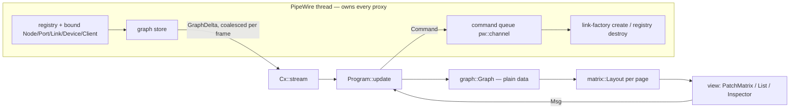

# Musubi architecture

Living document: every change must fit here or change this first. Product behaviour is in `design.md`; decisions in `decisions.md`.

## Repository and dependencies

One Cargo package, `aizome-musubi` (binary `aizome-musubi`, app id `org.aizome.Musubi`), shaped like Tsutsumi (`research/external-apps.md` §5, decision A4):

| Path | What |
|---|---|
| `src/` | the app (modules below) |
| `tests/` | Harness tests (fake backend), goldens in `tests/snapshots/`, live tests against a private PipeWire |
| `data/` | `org.aizome.Musubi.desktop`, `org.aizome.Musubi.svg` (+ its generator) |
| `nix/package.nix`, `flake.nix` | package, dev shell, checks, NixOS module `programs.musubi.enable`, VM check |
| `docs/` | this, `design.md`, `decisions.md`, `open-questions.md`, `research/`, `design/` (mockups, reviews) |

Dependencies: `aizome-kit` and `aizome-sys` by path from a sibling Sekka checkout (`../sekka/desktop/aizome/crates/`), pinned in `flake.nix` to Sekka `aebca32e…`; `pipewire` 0.10.1 (`v1_2_0`), as Sekka's own lock has it. `aizome-sys::audio::Audio` uses libpulse against pipewire-pulse for Pulse-visible controls; the package carries `libpulseaudio` at runtime.

## Layers

| Module | Owns | Never |
|---|---|---|
| `backend::pipewire` | the PipeWire MainLoop/Context/Core/Registry on one thread; proxies, listeners; command execution; epoch; reconnect | sends proxies across threads; blocks on the UI |
| `backend` | epoch-scoped handles; `Connect`/`Disconnect`/`Shutdown` commands and observed `Delta`/`CommandResult`/`Connection` events | guesses server results from requests |
| `backend::fake` | `pw-dump` fixture graph, deterministic link create/destroy deltas and injectable command failures (same `Backend` trait) | touches a PipeWire daemon |
| `backend::meters` | bounded (24) node-to-atomic-slot snapshots with per-channel F32 peaks and timestamps; UI polling decays values without waking on every callback | creates PipeWire connections or touches the callback's real-time path with locks/allocations |
| `graph` | plain-data store: clients, devices, nodes, ports, links, metadata; sparse `links_by_pair` and per-kind port index; pending out-of-order ports/links; epoch-gated `GraphDelta` with cascade removal | knows about pages or pixels |
| `mixer::model` | plain-data strips joining `AudioState` to graph nodes through PipeWire object serial/Pulse index (name cross-check), otherwise unique node name; read-only reasons for absent, ambiguous or mismatched identity; native-only rows only with observed writable `channelVolumes` | writes graph state, substitutes native Props for Pulse-visible controls |
| `graph::dump` | `pw-dump` JSON → graph deltas, including port EnumFormat summaries | talks to PipeWire |
| `graph::classify` | port kind (format.dsp → typed port EnumFormat → unambiguous media.class only when no EnumFormat); control type mask distinguishes MIDI 1.0 and UMP, otherwise unknown | — |
| `graph::group` | MIDI sequencer-client, device, client, node grouping; display labels, kinds and ordered ports | treats runtime IDs as persistent |
| `graph::legal` | output/input, media and comparable video raw/DSP EnumFormat-family preflight; MIDI 1.0↔UMP confirmation | overrides server refusal |
| `graph::identity` | live ID (`GlobalId` + epoch) and stable identity (device name + serial/bus, node name, direction, port name, sequencer client); ambiguity detection | persists runtime IDs |
| `matrix::layout` | for (page, view options, filters, folded groups): ordered row/column groups and lines, MIDI 1.0 group tags, offsets, active links plus negotiating/error overrides and error reasons; resolves a visible cell for a port pair | allocates the cross-product |
| `matrix::widget` (`PatchMatrix`) | fixed corner, scrolling headers/body, focus navigation and Table semantics with a focused Cell child carrying route state and toggle activation through `MatrixMsg::Toggle`; Return opens the row-port inspector; deferred click/line gesture and Bresenham preview | owns graph data or mutates links during pointer movement |
| `routes` | kit table of observed, asked and failed links on a page; stable physical-link selection, searchable source/destination lists in sunk wells in a modal Add Route sheet | changes graph data without app transactions |
| `undo` | stable port identities and observed intents; retains pending undo/redo entries until the request and its observation settle | replays runtime ids from another epoch |
| `app` | `Program`: model, command dispatch, sparse pending/errors, session conversion confirmation, context actions, re-link notice, transactions, menus and settings persistence | does I/O in `view` |

Later phases add: `mixer` widgets (`Fader`, `LevelMeter`), `devices`, `effects` (config generation + unit control), `clock` (settings metadata + profiler), `setups` + `keeper` (user service binary mode). Each gets a row here when it lands.

The phase-1 matrix derives immutable layouts per page after graph deltas. `ViewOptions` supplies pairs, swap, monitors, optional MIDI 1.0, independent From/To filters and folded group keys. Active Link globals alone count as connected; negotiating links display asked, and failed links display error with the PipeWire reason. The live and fixture EnumFormat summaries carry video raw/DSP families even without `format.dsp`; control type masks distinguish MIDI from UMP, and an ambiguous control mask stays unknown. Pending requests stay asked until observation; failed requests retain their reason. Sparse link and request states avoid allocating the row × column product.
The matrix retains its tree key across layout changes, reconciling focus, hover, press and line cells by surviving port identity or clamping/clearing them when rows shrink. `PatchMatrix` and the app share a focus handle for page-labelled Table semantics; its focused Cell child advertises route state and activation through the normal toggle command path.
Header dimensions are page-scoped view options saved alongside pairs/swap. A matrix layout carries its effective row and column header sizes; `PatchMatrix::view` clamps them to leave at least 240pt of body on both axes, and exports the body as an inspect part for the VM driver. A 12pt grip on the header's side of each header edge (never over the first cells) supports dragging and double-click fitting; Show Full Names computes the fit from current groups and labels. Stream subtitle bands are 16pt axis offsets and are excluded from cell hit testing.
The footer shows core-advertised default clock rate and quantum when both are known (and the resulting quantum duration); it is labelled “Defaults”, not measured latency. The fake backend advertises a fixture clock and version. Sidebar page counts are observed links classified by media type.
The sheet keeps its From/To search text aligned with any active matrix filter, and list rows inset their text. Empty and disconnected pages disable controls that have no matrix to act on. Cell errors use a red inset edge and red corner mark; focus and drag preview remain outer rings.

Click or Space submits a single-cell transaction; a line drag (or Shift-Space, arrows, Space) previews an inclusive Bresenham line and submits once on release/application, in the first cell's mode. Collapsed cells expand rather than submit; incompatible pairs are skipped with a reason. Pair-to-pair maps corresponding channels; pair-row-to-mono maps both channels to the one input. `app::Transaction` contains `LinkIntent { from: StableId, to: StableId, connect, request, result, observed }` per attempted link; `result` is the command acknowledgement and `observed` records that the graph reflected its effect. S4c undo must invert **only** successful observed intents, resolving identities against the current graph and skipping missing/ambiguous ports.

S4c records gesture transactions in `undo::History` as indices into the app's observed intent ledger. Undo resolves both stable port identities in the current graph, skips missing/ambiguous identities with a status message, and requests inverse actions only for intents acknowledged and observed. Redo inverts the observed undo transaction, not a stale runtime link ID. Inspector rows derive outgoing/incoming links and facts directly from the graph; each unlink row submits an explicit physical pair to the same transaction path, even when that pair is hidden by matrix filters. The selected port is retained by stable identity across graph changes and inspected only when resolution remains unique. Toolbar options live per page and rebuild layouts; status separates hover/notice at left from filter hidden counts or page port count at right.

## Matrix regions and scrolling

The corner stays fixed; column labels follow x only, row labels follow y only, and the body follows both. Wheel deltas clamp the widget's stored offsets to the content extents. The spike invalidates the affected header regions and the body on scroll (plus the corner in the wheel path), then redraws them; it does not ask the compositor to pixel-scroll overlapping regions. This keeps boundary pixels and clipped rotated labels correct for horizontal, vertical and diagonal movement without coordinating three disjoint scroll commands. Hover and focus instead invalidate old/new row and column bands, including their header labels; keyboard focus that reveals an offscreen cell uses the scroll redraw path. Measured release costs for both scales are in `performance.md`.

## Threads and messages
- UI thread: kit event loop, `Program`.
- PipeWire thread: everything PipeWire. Commands in: `Connect{out, in, confirmed, request}`, `Disconnect{link, request}`, `Shutdown` (+ later phases). Events out: `GraphDelta{epoch, upserts, removals}`, `CommandResult{request, Ok|Err(reason)}`, `Connection{Up(version)|Down(reason)}`. Deltas are batched on the PipeWire thread and flushed at most every 16 ms, so a burst (profile switch, app start) is one UI message.
- `PipeWireBackend` owns a named MainLoop thread, its registry and bound object listeners; its 16 ms timer flushes value-only graph deltas into `Cx::stream`. `global_remove` drops each bound listener and proxy. A broken connection (a core error with `-EPIPE`, or a failed core sync) tears down the session, advances the epoch, fails pending requests, emits `Down`, and retries with bounded backoff; other core errors (the server reports per-object ones such as "unknown resource" on the core too) fail only the request they belong to. The first core sync emits `Up`. Connect validates current epoch, ports and graph legality, creates a lingering link, and resolves successfully only when the matching link becomes active; a Link Error completes with its reason. Disconnect resolves on `global_remove`. Proxy errors and three-second timeouts fail requests without declaring a successful mutation. Metadata monitoring is not part of phase 1: no Metadata proxy is bound and `Graph::metadata` stays empty.
- `StartMeters(Vec<Handle>)` replaces the visible set (up to 24); extras are reported as paused. `StopMeters`, disappearing nodes and epoch teardown drop the capture streams. One F32 interleaved passive capture stream per metered node lives in the existing PipeWire session; sink monitors set `stream.capture.sink=true`. The RT process callback scans each channel into a preallocated atomic slot and stores a timestamp: no allocation, lock, logging, or GUI wake. The UI samples `Backend::meters()` only while a meter is visible (target 30 Hz) and decays stale peaks. Streams carry `application.id` and `musubi.meter=true`; the graph suppresses their nodes, ports and links on every page, and the mixer suppresses their Pulse recording entry.

## Identity
- Live actions: `(epoch, GlobalId)`. An epoch ends at disconnect; every pending command fails and the store is cleared.
- Persisted (Swap per page, folded groups, undo across reconnects, setups): stable identity; two live objects with the same stable identity are *ambiguous* and are never acted on by persisted state.
- Pulse service: `aizome_sys::audio::Audio` owns a long-lived libpulse thread; its `Wake` posts back to UI, where `generation()`/`snapshot()` read observed sinks, sources, streams and cards. Its commands alone write Pulse-visible volume, mute, balance and routing. Its snapshot does not expose proplists, but pipewire-pulse's Pulse device/stream `index` equals that graph node's `object.serial` on the tested pinned PipeWire (private Pulse JSON and graph in `runs/2026-11-20/patchbay/phase2/s1/`; reduced recorded fixture `tests/fixtures/private-pulse.json`). Device `name` must also match `node.name`; source monitors are omitted. If serial is missing, a unique `node.name` is the fallback for devices; zero/multiple matches and name disagreement disable controls with a reason. Index/serial is an incarnation bridge, never a persistent ID; it is re-resolved on every snapshot and graph epoch.
- Native-only audio nodes expose observed `Props.channelVolumes`/`mute` in graph deltas. The same PipeWire thread enumerates/subscribes to Props and checks both parameter WRITE and global W+X permissions. It sends `SetNodeVolume`/`SetNodeMute` via `Node::set_param(Props)` only when values/capabilities exist; submitted values do not modify the model. A subsequent Props read-back is the authoritative state. The mixer must exclude Pulse-bridged nodes from native control so one writer owns each control.

## Files
- Settings `$XDG_CONFIG_HOME/aizome/musubi.toml` (view options per page).
- Settings are per-page booleans (pairs, swap, monitors, MIDI 1.0, List), header sizes and full-name display; From/To queries stay transient. State `state.toml` stores folded groups by stable identity: device folds use device name plus serial/bus regardless of constituent node, while node groups retain node name. On each graph delta, saved identities are mapped to live group keys; absent groups remain saved until they return. App debounces changes for 350 ms and writes via a same-directory temporary file and rename. Harness persistence tests inject isolated config/state paths into their app constructor without changing process environment.
- Data `$XDG_DATA_HOME/aizome/musubi/` (setups, effect chains; later phases).
- One instance: `$XDG_RUNTIME_DIR/aizome-app.musubi.sock`.

## Testing seams
- `Backend` trait → `fake` for Harness tests and goldens (deterministic graphs: studio, laptop, MIDI rig, empty, disconnected).
- `scripts/private-pipewire` runs a private daemon without WirePlumber or host-device monitors. Static null adapters expose Test Interface Output (`Audio/Sink`, AUX0–AUX3), Test Interface Input (`Audio/Source`, AUX0–AUX3), and Test Mic (`Audio/Source`, MONO); their playback and source-monitor ports have `format.dsp = "32 bit float mono audio"`. Clients provide stereo playback (`Stream/Output/Audio`), mono capture (`Stream/Input/Audio`), MIDI playback (`Stream/Output/Midi`) and capture (`Stream/Input/Midi`) with `format.dsp = "8 bit raw midi"` on both MIDI ports, and a software-generated `Video/Source` with a `capture_1` port (no `format.dsp` property). Unlinked audio clients have no ports without a session manager; UMP is not represented.
- The launcher also starts pipewire-pulse with its socket under the private runtime directory and exports `PULSE_SERVER=unix:<private>/pulse/native`; live probes explicitly use that address, never the host session. Test Speakers (`Audio/Sink`, stereo FL/FR) is created through Pulse's `module-null-sink`, not a static PipeWire adapter: without WirePlumber, a Pulse write against the static adapter acknowledges success but leaves its native gain at unity. The separate `Audio/Filter` null adapter `musubi_native_only` has writable `Props.channelVolumes`, is omitted from Pulse sink/source lists, and exercises the native-only path.
- Live evidence is `tests/fixtures/private.json`, with link-create/remove and isolation transcript in `runs/2026-11-11/patchbay/phase1/s1c/`. This proves only the private PipeWire instance, not hardware.
- VM seam (`nix/vm-test.{nix,py}`): NixOS guest imports the pinned Sekka Aizome module and Musubi module; greetd starts an Aizome session, WirePlumber manages a `pw-play` stream, two null sinks expose separate FL/FR inputs, and `snd-virmidi` exposes virtual MIDI clients (no video device: the test kernel lacks `vivid`). `AIZOME_KIT_INSPECT` records the packaged app's actual widget rectangles: a driver uses these with the matrix header dimensions to click cells through compositor pointer input, then checks the audio link with `pw-link -l` and the MIDI link as a Link global joining exactly the chosen ports. Undo is a compositor keyboard chord. Screenshot sequence, inspect JSON, inputs and journal are VM evidence only; when a wait fails, the driver prints that evidence to the build log.
