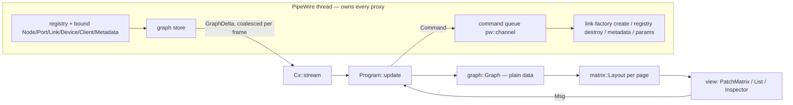

# Musubi architecture

Living document: every change must fit here or change this first. Product behaviour is in `design.md`; decisions in `decisions.md`.

## Repository and dependencies

One Cargo package, `aizome-musubi` (binary `aizome-musubi`, app id `org.aizome.Musubi`), shaped like Tsutsumi (`research/external-apps.md` §5, decision A4):

| Path | What |
|---|---|
| `src/` | the app (modules below) |
| `tests/` | Harness tests (fake backend), goldens in `tests/snapshots/`, live tests against a private PipeWire |
| `data/` | `org.aizome.Musubi.desktop`, `org.aizome.Musubi.svg` (+ its generator) |
| `nix/package.nix`, `flake.nix` | package, dev shell, checks, NixOS module `programs.musubi.enable`, VM check |
| `docs/` | this, `design.md`, `decisions.md`, `open-questions.md`, `research/`, `design/` (mockups, reviews) |

Dependencies: `aizome-kit` by path from a sibling Sekka checkout (`../sekka/desktop/aizome/crates/aizome-kit`), pinned in `flake.nix` to Sekka `aebca32e…`; `pipewire` 0.10.1 (`v1_2_0`), as Sekka's own lock has it. Later phases add `aizome-sys` (Pulse service) the same way.

## Layers

| Module | Owns | Never |
|---|---|---|
| `backend::pipewire` | the PipeWire MainLoop/Context/Core/Registry on one thread; proxies, listeners; command execution; epoch; reconnect | sends proxies across threads; blocks on the UI |
| `backend` | epoch-scoped handles; `Connect`/`Disconnect`/`Shutdown` commands and observed `Delta`/`CommandResult`/`Connection` events | guesses server results from requests |
| `backend::fake` | `pw-dump` fixture graph, deterministic link create/destroy deltas and injectable command failures (same `Backend` trait) | touches a PipeWire daemon |
| `graph` | plain-data store: clients, devices, nodes, ports, links, metadata; sparse `links_by_pair` and per-kind port index; pending out-of-order ports/links; epoch-gated `GraphDelta` with cascade removal | knows about pages or pixels |
| `graph::dump` | `pw-dump` JSON → graph deltas, including port EnumFormat summaries | talks to PipeWire |
| `graph::classify` | port kind (format.dsp → port EnumFormat → unambiguous media.class), channel position, strict FL/FR pairing | — |
| `graph::group` | MIDI sequencer-client, device, client, node grouping; display labels, kinds and ordered ports | treats runtime IDs as persistent |
| `graph::legal` | output/input, media and video-format-family preflight; MIDI 1.0↔UMP confirmation | overrides server refusal |
| `graph::identity` | live ID (`GlobalId` + epoch) and stable identity (device name + serial/bus, node name, direction, port name, sequencer client); ambiguity detection | persists runtime IDs |
| `matrix::layout` | for (page, view options, filters, folded groups): ordered row/column groups and lines, offsets, cell state lookup | allocates the cross-product |
| `matrix::widget` (`PatchMatrix`) | fixed corner, x-scrolling column header, y-scrolling row header, xy-scrolling body; clamped offsets in widget state, pitch-based hit testing, clipped drawing, targeted hover/focus damage and redraw-on-scroll, table semantics | owns graph data (gets an `Rc<Layout>`) |
| `routes` (List view) | kit `table` over the page's links; Add Route sheet | — |
| `undo` | transactions of link intents by stable identity; inverse on observed results only | replays runtime ids from another epoch |
| `app` | `Program`: model, `Msg`, `update`, `view`, menus, settings persistence | does I/O in `view` |

Later phases add: `mixer` (strips, `Fader`, `LevelMeter`; Pulse bridge), `meters` (peak streams on the PipeWire thread), `devices`, `effects` (config generation + unit control), `clock` (settings metadata + profiler), `setups` + `keeper` (user service binary mode). Each gets a row here when it lands.

The phase-1 matrix display derives one immutable `Layout` per page after each graph delta. `ViewOptions` supplies pairs, swap, monitors, optional MIDI 1.0, independent From/To filters, and folded group keys. The layout stores ordered group/line metadata, sparse observed link pairs and sparse request-state overrides; `state(cell)` computes visible pair/channel/aggregate states without allocating the row × column product. `hidden_from` and `hidden_to` count filtered physical ports before pair/fold aggregation. The app retains `Rc<Layout>` per page across frames (rather than rebuilding in `view`); request-state updates and editing actions belong to the next interaction stage.

## Matrix regions and scrolling

The corner stays fixed; column labels follow x only, row labels follow y only, and the body follows both. Wheel deltas clamp the widget's stored offsets to the content extents. The spike invalidates the affected header regions and the body on scroll (plus the corner in the wheel path), then redraws them; it does not ask the compositor to pixel-scroll overlapping regions. This keeps boundary pixels and clipped rotated labels correct for horizontal, vertical and diagonal movement without coordinating three disjoint scroll commands. Hover and focus instead invalidate old/new row and column bands, including their header labels; keyboard focus that reveals an offscreen cell uses the scroll redraw path. Measured release costs for both scales are in `performance.md`.

## Threads and messages
- UI thread: kit event loop, `Program`.
- PipeWire thread: everything PipeWire. Commands in: `Connect{out, in, confirmed, request}`, `Disconnect{link, request}`, `Shutdown` (+ later phases). Events out: `GraphDelta{epoch, upserts, removals}`, `CommandResult{request, Ok|Err(reason)}`, `Connection{Up(version)|Down(reason)}`. Deltas are batched on the PipeWire thread and flushed at most every 16 ms, so a burst (profile switch, app start) is one UI message.
- `PipeWireBackend` owns a named MainLoop thread, its registry and bound object listeners; its 16 ms timer flushes value-only graph deltas into `Cx::stream`. `global_remove` drops each bound listener and proxy. Core errors tear down the session, advance the epoch, fail pending requests, emit `Down`, and retry with bounded backoff; the first core sync emits `Up`. The app shows per-page live port/link counts or an unavailable state. Connect validates current epoch, ports and graph legality (MIDI conversion needs `confirmed`), creates a lingering link via `link-factory`, and resolves only when the matching link global is observed; disconnect resolves only on `global_remove`. Proxy errors and three-second timeouts fail their requests without declaring a successful mutation.

## Identity
- Live actions: `(epoch, GlobalId)`. An epoch ends at disconnect; every pending command fails and the store is cleared.
- Persisted (Swap per page, folded groups, undo across reconnects, setups): stable identity; two live objects with the same stable identity are *ambiguous* and are never acted on by persisted state.

## Files
- Settings `$XDG_CONFIG_HOME/aizome/musubi.toml` (view options per page).
- State `$XDG_STATE_HOME/aizome/musubi/` (folded groups, window).
- Data `$XDG_DATA_HOME/aizome/musubi/` (setups, effect chains; later phases).
- One instance: `$XDG_RUNTIME_DIR/aizome-app.musubi.sock`.

## Testing seams
- `Backend` trait → `fake` for Harness tests and goldens (deterministic graphs: studio, laptop, MIDI rig, empty, disconnected).
- `scripts/private-pipewire` runs a private daemon without WirePlumber or host-device monitors. Static null adapters expose Test Speakers (`Audio/Sink`, stereo FL/FR), Test Interface Output (`Audio/Sink`, AUX0–AUX3), Test Interface Input (`Audio/Source`, AUX0–AUX3), and Test Mic (`Audio/Source`, MONO); their playback and source-monitor ports have `format.dsp = "32 bit float mono audio"`. Clients provide stereo playback (`Stream/Output/Audio`), mono capture (`Stream/Input/Audio`), MIDI playback (`Stream/Output/Midi`) and capture (`Stream/Input/Midi`) with `format.dsp = "8 bit raw midi"` on both MIDI ports, and a software-generated `Video/Source` with a `capture_1` port (no `format.dsp` property). Unlinked audio clients have no ports without a session manager; UMP is not represented.
- Live evidence is `tests/fixtures/private.json`, with link-create/remove and isolation transcript in `runs/2026-11-11/patchbay/phase1/s1c/`. This proves only the private PipeWire instance, not hardware.
- VM check: NixOS VM with `snd-virmidi` (MIDI bridge) and `vivid` (video), driving the packaged app with real input; screenshots for `sekka-visual`.
